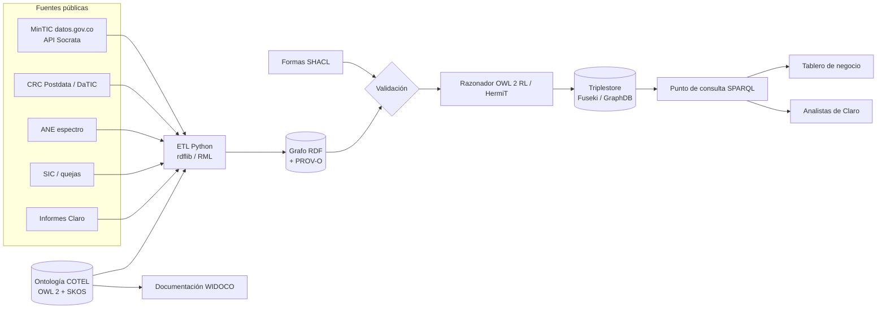
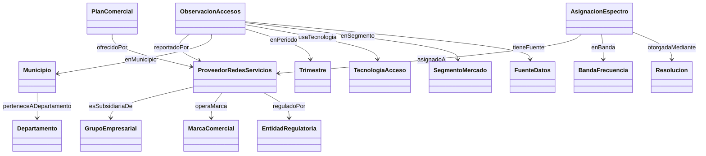

# Propuesta de proyecto de grado

## COTEL: ontología y grafo de conocimiento de datos públicos del sector de telecomunicaciones en Colombia. Caso Claro

**Modalidad sugerida:** monografía aplicada, con un artículo derivado. La sección 16 compara las dos modalidades.
**Área de conocimiento:** web semántica, ingeniería ontológica, datos abiertos enlazados y grafos de conocimiento.
**Empresa beneficiaria:** Claro Colombia (Comunicación Celular S.A. – Comcel S.A.).
**Restricción de diseño:** el proyecto solo usa **información pública**. No usa datos de clientes ni información interna o confidencial.

---

## 1. Resumen

Los datos públicos sobre el mercado colombiano de telecomunicaciones están dispersos. MinTIC y la CRC publican accesos, ingresos y calidad. La ANE publica el espectro y la SIC las quejas, y los operadores publican sus propios informes. Cada fuente usa formatos, códigos y nombres distintos. Por eso, preguntas como *"¿cuál es la participación de Claro en fibra por departamento?"* o *"¿en qué municipios hay demanda y Claro no tiene presencia?"* exigen cruces manuales en hojas de cálculo, que tardan, cuestan reproducir y carecen de trazabilidad.

Este proyecto diseña **COTEL**, una ontología OWL 2 que reutiliza estándares del W3C (ORG, schema.org, RDF Data Cube, SKOS, OWL-Time, GeoSPARQL, DCAT y PROV-O). Con ella se construye un **grafo de conocimiento** que integra esas fuentes públicas. El grafo se valida con SHACL, admite inferencias con un razonador y se consulta con SPARQL.

El producto para la empresa es un **punto de consulta semántico**, acompañado de un catálogo de preguntas de negocio resueltas. Las áreas destinatarias son Asuntos Regulatorios, Inteligencia de Mercado y Planeación Comercial.

La evaluación combina cuatro frentes:
- calidad de la ontología (OOPS!, FOOPS! y consistencia lógica);
- cobertura de las preguntas de competencia;
- calidad de los datos (SHACL);
- utilidad percibida por usuarios de Claro, medida con SUS y con el tiempo de respuesta frente al proceso manual.

**Palabras clave:** ontología, web semántica, datos abiertos enlazados, grafo de conocimiento, telecomunicaciones, OWL, SPARQL, SHACL, Colombia.

---

## 2. Planteamiento del problema

En Colombia hay abundante información pública sobre telecomunicaciones:
- **MinTIC (datos.gov.co):** accesos de internet fijo por proveedor, municipio, tecnología, segmento y velocidad, publicados cada trimestre desde 2010.
- **CRC (Postdata / DaTIC):** suscriptores, ingresos, tráfico, calidad de servicio y PQR.
- **ANE:** asignaciones de espectro y subastas.
- **SIC:** sanciones y quejas de protección al usuario.
- **Operadores:** informes de sostenibilidad y ofertas comerciales publicadas.

Esa información tiene cuatro problemas:

1. **Heterogeneidad sintáctica y semántica.** El mismo concepto aparece con nombres distintos. Por ejemplo, "COMUNICACION CELULAR S A COMCEL S A" es Claro, y "TELMEX COLOMBIA S.A." es una razón social histórica de su operación fija. Las tecnologías se publican como texto libre (*"FIBER TO THE HOME (FTTH)"*, *"OTRAS TECNOLOGÍAS DE FIBRA (ANTES FTTX)"*), sin jerarquía.
2. **Ausencia de enlaces entre fuentes.** No hay identificadores comunes que conecten un municipio, un operador o una banda de espectro entre conjuntos de datos.
3. **Falta de trazabilidad.** Al consolidar en Excel se pierde de qué fuente, versión y fecha viene cada cifra.
4. **Costo de análisis.** Cada pregunta nueva exige descargar, limpiar y cruzar archivos a mano.

**Pregunta de investigación:**
> ¿En qué medida una ontología OWL basada en estándares de la web semántica permite integrar fuentes públicas heterogéneas del sector de telecomunicaciones colombiano y responder preguntas de negocio de Claro de forma correcta, trazable y más eficiente que el proceso manual?

---

## 3. Justificación

**Académica**
- Hay ontologías de telecomunicaciones orientadas a la **infraestructura de red**, como ToCo (Zhou, Gray y McLaughlin, 2019), y modelos industriales como **TM Forum SID**. Ninguna modela el **mercado regulado** con datos abiertos gubernamentales, y menos en el contexto colombiano.
- El proyecto aplica metodologías reconocidas (NeOn y Linked Data) y métricas de evaluación aceptadas (OOPS!, FOOPS!, preguntas de competencia y SHACL).

**Empresarial (valor para Claro)**

| Área de Claro | Uso concreto |
|---|---|
| Asuntos Regulatorios | Responder a la CRC o a MinTIC con cifras trazables. Monitorear la participación de mercado, que es relevante en la discusión sobre posición dominante, y consultar normas por servicio. |
| Inteligencia de Mercado / Estrategia | Comparar con la competencia por municipio, tecnología y estrato, y ver la evolución trimestral. |
| Planeación Comercial / Expansión | Detectar municipios con demanda y sin presencia de Claro, y priorizar el despliegue de fibra. |
| Sostenibilidad | Integrar indicadores ESG publicados con las métricas de cobertura (brecha digital por estrato). |
| Gobierno de Datos / Analítica | Usar la ontología como glosario corporativo y modelo de referencia reutilizable. |

**Social y normativa:** el proyecto se alinea con la Ley 1712 de 2014 (transparencia y acceso a la información pública), con el CONPES 3920 de 2018 (política de explotación de datos) y con los principios FAIR.

---

## 4. Objetivos

**Objetivo general**
Diseñar, implementar y evaluar una ontología OWL 2 y un grafo de conocimiento que integren datos públicos del sector de telecomunicaciones colombiano, para apoyar las preguntas de negocio de áreas de Claro Colombia.

**Objetivos específicos**
1. Especificar los requisitos de la ontología mediante un documento ORSD y preguntas de competencia, validadas con al menos dos áreas de Claro.
2. Conceptualizar e implementar la ontología COTEL en OWL 2, reutilizando vocabularios estándar del W3C y de la OGC.
3. Construir un proceso reproducible de extracción, transformación y carga (ETL) que convierta al menos tres fuentes públicas en RDF con trazabilidad PROV-O.
4. Evaluar la ontología y el grafo en cuatro frentes: calidad ontológica (OOPS!, FOOPS! y razonador), calidad de datos (SHACL), cobertura de las preguntas de competencia y utilidad para el usuario (SUS y tiempo de respuesta frente al proceso manual).
5. Publicar el grafo en un punto de consulta SPARQL, con documentación (WIDOCO) y un tablero de consultas para la empresa.

---

## 5. Alcance y limitaciones

**Incluye**
- Internet fijo (MinTIC), ya implementado en el prototipo.
- Indicadores de telefonía e internet móvil (CRC).
- Espectro (ANE).
- Quejas y PQR (CRC/SIC).
- Datos corporativos públicos de Claro.
- Planes comerciales publicados (fase opcional).

**No incluye**
- Datos de clientes, datos personales (Ley 1581 de 2012) o información interna de Claro.
- Predicción o modelos de aprendizaje automático (pueden plantearse como trabajo futuro).

**Limitaciones**
- Las fuentes públicas tienen rezago. Por ejemplo, el conjunto `n48w-gutb` está actualizado hasta 2023-T3 a la fecha de consulta.
- Las velocidades son **de plan**, no medidas.
- Algunos datos (NIT, fechas de fusión) deben verificarse en la fuente oficial.

---

## 6. Marco teórico

| Concepto | Referencia |
|---|---|
| Web semántica | Berners-Lee, Hendler y Lassila (2001) |
| Ontología: *"especificación explícita de una conceptualización"* | Gruber (1993); Studer, Benjamins y Fensel (1998) |
| RDF 1.1, RDFS, OWL 2, SPARQL 1.1 | Recomendaciones del W3C |
| SHACL: validación en mundo cerrado frente a la semántica de mundo abierto de OWL | W3C (2017) |
| Datos enlazados y modelo de 5 estrellas | Berners-Lee (2006); Heath y Bizer (2011) |
| Grafos de conocimiento | Hogan et al. (2021) |
| Ingeniería ontológica | METHONTOLOGY (Fernández-López et al., 1997); NeOn (Suárez-Figueroa et al., 2012); Noy y McGuinness (2001) |
| Vocabularios reutilizados | ORG, schema.org, RDF Data Cube (qb), SKOS, OWL-Time, GeoSPARQL, DCAT, PROV-O |
| Evaluación | OOPS! (Poveda-Villalón et al., 2014); FOOPS! (Garijo et al., 2021); WIDOCO (Garijo, 2017) |

**Contexto regulatorio colombiano**
- Ley 1341 de 2009 (Ley TIC), modificada por la Ley 1978 de 2019.
- Funciones de la CRC, MinTIC, ANE y SIC.
- Proveedores de Redes y Servicios de Telecomunicaciones (PRST).
- Codificación DIVIPOLA del DANE.

---

## 7. Estado del arte (punto de partida para la revisión sistemática)

| Trabajo | Aporte | Diferencia con COTEL |
|---|---|---|
| Zhou, Gray y McLaughlin (2019). *ToCo: an ontology for representing hybrid telecommunication networks*. Journal of Web Semantics. | Ontología de infraestructura de red (dispositivo, interfaz y enlace). | Se centra en la red física, no en el mercado ni en la regulación. |
| TM Forum SID (Information Framework). | Modelo de información de referencia de la industria. | Es un modelo UML/industrial, no OWL abierto, y no cubre datos gubernamentales. |
| Mehmood, Kralevska y Palma (2023). *Knowledge-based intent modeling for next generation cellular networks*. | Grafos de conocimiento para redes basadas en intención. | Dominio operativo de red. |
| Krinkin et al. (ca. 2020). *Models of telecommunications network monitoring based on knowledge graphs*. CEUR-WS Vol. 2723. | Monitoreo de red con RDF. | Dominio operativo de red. |
| W3C Government Linked Data (2014). *Best Practices for Publishing Linked Data*; ORG; RDF Data Cube. | Prácticas para publicar estadística pública. | COTEL las aplica al sector TIC colombiano. |

**Vacío identificado:** no se encontró una ontología abierta que modele el **mercado de telecomunicaciones colombiano** (operadores, regulación, estadística trimestral, territorio DIVIPOLA y espectro) con trazabilidad de la fuente.

**Búsqueda recomendada:** Scopus, IEEE Xplore, ACM DL y SpringerLink, con la cadena `("ontology" OR "knowledge graph" OR "linked data") AND ("telecommunication*" OR "telecom") AND ("open data" OR "regulat*" OR "market")`, para el periodo 2012-2026. Para la selección de estudios, aplicar PRISMA.

---

## 8. Metodología

Se combina **NeOn**, en los escenarios 1 (desde cero), 2 (reutilización de recursos no ontológicos) y 3 (reutilización de ontologías), con las **guías de publicación de datos enlazados gubernamentales** del W3C.

| Fase | Actividades | Entregable |
|---|---|---|
| F1. Especificación | Entrevistas con Regulatorio, Mercado y Planeación. Redacción de las preguntas de competencia. | Documento ORSD y lista de preguntas de competencia (sección 9). |
| F2. Reutilización | Selección de vocabularios en LOV (Linked Open Vocabularies) y alineación con ORG, qb, SKOS, etc. | Matriz de reutilización. |
| F3. Conceptualización e implementación | Glosario, taxonomías, relaciones y axiomas. Implementación en Protégé / Turtle. | `ontologia/cotel.ttl` |
| F4. Población (ETL) | Descarga por API Socrata, normalización, URIs persistentes (w3id.org) y PROV-O. Como alternativa declarativa, RML con Morph-KGC. | `pipeline/` y grafo RDF |
| F5. Validación | SHACL de calidad de datos, razonador HermiT/Pellet de consistencia, OOPS! y FOOPS!. | `ontologia/cotel-shapes.ttl` y reportes |
| F6. Explotación | Punto de consulta (Apache Jena Fuseki o GraphDB Free), consultas de competencia y tablero. | Servicio desplegado y catálogo de consultas |
| F7. Evaluación con usuarios | Comparar el tiempo y la exactitud de respuesta con el grafo frente al proceso manual en Excel, con 5 a 8 usuarios de Claro. Cuestionario SUS. | Informe de evaluación |
| F8. Documentación | Documentación HTML con WIDOCO, monografía y artículo. | Documentos finales |

### Diseño de la evaluación

| Dimensión | Métrica | Meta |
|---|---|---|
| Consistencia lógica | HermiT: ontología coherente, sin clases insatisfacibles | 100 % |
| Calidad del modelado | Problemas de modelado críticos o importantes según OOPS! | 0 críticos |
| Principios FAIR | Puntaje FOOPS! | ≥ 70 % |
| Cobertura funcional | Preguntas de competencia respondidas por SPARQL | ≥ 90 % |
| Calidad de datos | Violaciones SHACL / observaciones | 0 violaciones |
| Exactitud | Diferencia entre el total del grafo y el total de la fuente original | 0 |
| Eficiencia | Tiempo mediano por pregunta: grafo frente a Excel | Reducción ≥ 50 % |
| Usabilidad | System Usability Scale | ≥ 68 |

---

## 9. Preguntas de competencia (requisitos funcionales)

| ID | Pregunta | Fuente | Estado |
|---|---|---|---|
| CQ1 | ¿Cuántos accesos de internet fijo tiene Claro y cuál es su participación nacional frente a los principales competidores? | MinTIC | ✅ Implementada |
| CQ2 | ¿Cuál es la participación de Claro por departamento? | MinTIC + DIVIPOLA | ✅ Implementada |
| CQ3 | ¿Cómo se distribuyen los accesos de Claro por familia tecnológica? | MinTIC + SKOS | ✅ Implementada |
| CQ4 | ¿En qué municipios con demanda relevante no tiene presencia Claro? | MinTIC | ✅ Implementada |
| CQ5 | ¿Cuál es la velocidad de plan promedio de Claro frente al mercado, por estrato? | MinTIC | ✅ Implementada |
| CQ6 | ¿En qué municipios donde Claro tiene presencia la competencia ya tiene alta penetración de fibra (FTTx)? (amenaza competitiva) | MinTIC + inferencia | ✅ Implementada |
| CQ7 | ¿De qué fuente y publicador proviene cada dato? | DCAT / PROV | ✅ Implementada |
| CQ8 | ¿Quién controla a Claro, qué razones sociales absorbió y quién lo regula? | Curada | ✅ Implementada |
| CQ9 | ¿Cómo evolucionó trimestre a trimestre la participación de Claro en fibra? | MinTIC histórico | Fase 2 |
| CQ10 | ¿Cuánto espectro tiene asignado cada operador por banda y con qué acto administrativo? | ANE | Fase 2 |
| CQ11 | ¿Cuál es la tasa de quejas por cada 10.000 usuarios de Claro frente a la competencia? | CRC / SIC | Fase 2 |
| CQ12 | ¿Qué resoluciones de la CRC aplican al servicio de internet fijo vigentes en un periodo? | CRC | Fase 2 |
| CQ13 | ¿Qué relación hay entre el estrato y la adopción de fibra en los municipios donde Claro tiene presencia? | MinTIC | Fase 2 |

---

## 10. Arquitectura del producto

---

## 11. Modelo conceptual de la ontología (resumen)

**Decisiones de diseño relevantes**
- **Observaciones como entidades** (patrón RDF Data Cube): permiten series temporales y dimensiones múltiples sin recurrir a la reificación.
- **Tecnologías y segmentos como SKOS**: guardan el literal original (`skos:altLabel`) y una jerarquía (`skos:broader`). La ontología es la que *dirige* el mapeo del ETL.
- **Clases definidas** (`ObservacionFibraOptica` ≡ ObservacionAccesos ⊓ ∃usaTecnologia.TecnologiaFibra): el razonador clasifica sin código adicional.
- **`ubicadoEn` transitiva**: municipio → departamento → país.
- **Separación entre OWL (mundo abierto) y SHACL (mundo cerrado)**: OWL se usa para inferir y SHACL para controlar la calidad.
- **Trazabilidad**: cada observación declara su `cot:tieneFuente` (subpropiedad de `prov:wasDerivedFrom`) y el número de registros originales agregados.

---

## 12. Resultados preliminares (prototipo funcional ya construido)

Prototipo ejecutado sobre el corte **2023-T3** del dataset MinTIC `n48w-gutb` (el más reciente publicado al momento de la consulta). El detalle está en `resultados/resumen.json`, `resultados/verificacion_owl_dl.json` y los CSV de cada pregunta de competencia.

### 12.1 Ontología y grafo

| Métrica | Valor |
|---|---|
| Clases OWL propias | 41 (más clases reutilizadas de ORG, qb, DCAT, etc.) |
| Propiedades de objeto / de datos | 24 / 19 |
| Esquemas SKOS / conceptos | 2 / 35 (25 tecnologías en 7 familias, 10 segmentos) |
| Formas SHACL | 6 |
| Registros crudos MinTIC | 208.803 |
| Observaciones agregadas (`qb:Observation`) | 23.317 |
| Proveedores / municipios | 1.010 / 1.117 |
| Tripletas del grafo | ≈ 311.800 |

### 12.2 Validación

| Prueba | Resultado |
|---|---|
| Pruebas unitarias (pytest) | 15/15 aprobadas |
| SHACL (23.317 observaciones + entidades de referencia) | **Conforme: 0 violaciones**, 236 advertencias (velocidades > 10.000 Mbps reportadas en la fuente) |
| HermiT (OWL 2 DL), muestra de Bogotá: 4.192 tripletas | **Consistente**, 0 clases insatisfacibles (16 s) |
| OWL 2 RL (owlrl), misma muestra | 4.190 → 10.428 tripletas. 117 observaciones inferidas como `ObservacionFibraOptica` y 145 como `ObservacionAltaVelocidad`. Las cifras coinciden con HermiT. |
| Axiomas comprobados | Transitividad municipio → Colombia ✔, inversa `controla` (América Móvil → Comcel) ✔, herencia de subclases ✔ |
| Exactitud frente a la fuente | El total nacional del grafo (8.946.322 accesos) coincide con la suma del CSV original |

### 12.3 Respuestas a las preguntas de competencia (8/8 respondidas = 100 %)

- **CQ1:** Claro (Comcel) lidera internet fijo con **3.242.287 accesos (36,24 %)**. Le siguen UNE-Tigo (18,77 %), Movistar (16,12 %), ETB (7,37 %) y DirecTV (1,25 %).
- **CQ2:** las mayores participaciones de Claro están en San Andrés (58,3 %), Cundinamarca (49,9 %), Bogotá (46,6 %), Casanare (46,1 %) y Cauca (45,7 %).
- **CQ3:** Claro reporta el 99,7 % de sus accesos como **cable coaxial (HFC)** y el resto como inalámbrico fijo. No reporta FTTH.
- **CQ4 (oportunidad):** los municipios con mayor demanda sin presencia de Claro son Peñol (11.453 accesos), Maicao (11.035), El Bagre (10.194), Dagua (8.909), Fundación (7.006) y Saravena (6.544).
- **CQ5:** en estratos 1 y 2, Claro ofrece velocidades de plan promedio mayores que el resto del mercado (153 frente a 104 Mbps y 200 frente a 151 Mbps). En el segmento corporativo está ligeramente por debajo (235 frente a 245 Mbps).
- **CQ6 (amenaza):** en Bogotá, el **79,6 %** de los accesos de la competencia ya es fibra, frente a una cuota de Claro del 46,6 %. Se observa un patrón similar en Zipaquirá (77,9 %), Madrid (77,7 %), Facatativá (74,6 %), Tuluá (73,5 %) y Cajicá (72,0 %).
- **CQ7:** cada observación es trazable hasta el dataset y el publicador (MinTIC) mediante DCAT/PROV-O.
- **CQ8:** el grafo responde que América Móvil controla a Comcel, que esta absorbió a Telmex Colombia y que la regulan MinTIC, CRC, ANE y SIC.

### 12.4 Hallazgos de calidad de datos (aporte del enfoque semántico)

1. La API entrega todas las columnas como texto y las velocidades con coma decimal. Por eso no se pueden agregar en el servidor y el ETL tuvo que normalizarlas.
2. Hay velocidades atípicas de hasta 500.000 Mbps. SHACL las detecta automáticamente como advertencias.
3. La clasificación tecnológica que reporta Claro (solo "CABLE") no permite distinguir el despliegue FTTH. Esta brecha de calidad del dato regulatorio es útil para el área de Regulación.
4. El dataset histórico mantiene la razón social de Telmex Colombia (fusionada en Comcel). La ontología lo modela con `cot:fusionadaEn` para unificar las series.

---

## 13. Cronograma (16 semanas, un semestre)

| Semana | 1-2 | 3-4 | 5-6 | 7-8 | 9-10 | 11-12 | 13-14 | 15-16 |
|---|---|---|---|---|---|---|---|---|
| F1 Especificación (entrevistas, preguntas de competencia) | ██ | | | | | | | |
| Revisión sistemática (estado del arte) | ██ | ██ | | | | | | |
| F2-F3 Reutilización e implementación OWL | | ██ | ██ | | | | | |
| F4 ETL: MinTIC (histórico) + CRC | | | ██ | ██ | | | | |
| F4 ETL: ANE + SIC + datos corporativos | | | | ██ | ██ | | | |
| F5 Validación (SHACL, OOPS!, FOOPS!, HermiT) | | | | | ██ | ██ | | |
| F6 Fuseki/GraphDB + tablero | | | | | | ██ | | |
| F7 Evaluación con usuarios de Claro | | | | | | | ██ | |
| F8 Monografía, artículo y sustentación | | | | | | ██ | ██ | ██ |

---

## 14. Recursos y presupuesto

Todo el software es libre: Protégé, Python con rdflib, pySHACL y owlrl, Apache Jena Fuseki o GraphDB Free, WIDOCO, OOPS! y FOOPS!.

- **Infraestructura:** basta un portátil. Opcionalmente, una máquina virtual con 4 GB de RAM para el punto de consulta.
- **Costo monetario estimado:** ≈ $0, más las horas de los usuarios evaluadores (5 a 8 personas × 1 h).

---

## 15. Riesgos y mitigación

| Riesgo | Probabilidad | Mitigación |
|---|---|---|
| Que la empresa considere sensible incluso un producto con datos públicos | Media | Usar solo fuentes públicas citadas. Obtener aval escrito del jefe o del área legal para usar el nombre "Claro" en la publicación. Plan B: un caso genérico de "operador líder". |
| Cambios de esquema o rezago en las APIs públicas | Alta | Fijar el corte, guardar copias crudas con fecha, usar ETL parametrizado y pruebas. |
| Que los datos de la ANE o la SIC estén en PDF o en formato no estructurado | Alta | Recolección semiautomática acotada (p. ej., solo las subastas de 2019 y 2023). |
| Rendimiento del razonador sobre grafos grandes | Media | OWL 2 RL o razonamiento sobre muestras, y reglas SPARQL o SHACL-AF. |
| Disponibilidad de usuarios para la evaluación | Media | Agendar desde la semana 1 con el área patrocinadora. |

---

## 16. Monografía o artículo

| Criterio | Monografía | Artículo |
|---|---|---|
| Extensión | 60 a 100 páginas | 12 a 20 páginas |
| Ventaja | Documenta todo el producto (ETL, ontología y evaluación), lo cual resulta útil como manual para Claro. | Visibilidad académica y publicación indexada. |
| Recomendación | **Monografía + artículo corto derivado** | |

### Estructura de la monografía
1. Introducción (problema, objetivos, alcance)
2. Marco teórico
3. Estado del arte (revisión sistemática)
4. Metodología (NeOn + datos enlazados)
5. Especificación (ORSD y preguntas de competencia)
6. Diseño e implementación de COTEL
7. Población del grafo (ETL y trazabilidad)
8. Evaluación (técnica y con usuarios)
9. Producto para Claro (despliegue, casos de uso, manual)
10. Conclusiones y trabajo futuro
- Anexos: documentación WIDOCO, consultas SPARQL, formas SHACL y código.

### Estructura del artículo (IMRyD)
Introducción · Trabajos relacionados · Metodología · La ontología COTEL · Población y validación · Evaluación · Discusión · Conclusiones.

### Posibles revistas o eventos
- **Eventos:** KGSWC (Iberoamerican Knowledge Graphs and Semantic Web Conference); sesiones de pósteres y demostraciones de ESWC o ISWC; Congreso Colombiano de Computación.
- **Revistas colombianas:** *TecnoLógicas*, *Ingeniería y Ciencia*, *DYNA*, *Ingeniería e Investigación*.
- Verifica el alcance y la indexación vigentes de cada una.

---

## 17. Trabajo futuro
- Enlazar con Wikidata y con la DIVIPOLA geoespacial (geometrías WKT) para mapas.
- Interfaz en lenguaje natural sobre el grafo (de texto a SPARQL con LLM), con respuestas verificables.
- Publicar la ontología en w3id.org y en LOV.
- Extender al ecosistema regional de América Móvil.

---

## 18. Referencias (verifica el formato que exija tu universidad)

- Berners-Lee, T. (2006). *Linked Data – Design Issues*. W3C.
- Berners-Lee, T., Hendler, J., & Lassila, O. (2001). The Semantic Web. *Scientific American, 284*(5), 34-43.
- Fernández-López, M., Gómez-Pérez, A., & Juristo, N. (1997). METHONTOLOGY: From ontological art towards ontological engineering. *AAAI Spring Symposium*.
- Garijo, D. (2017). WIDOCO: A wizard for documenting ontologies. *ISWC 2017*, LNCS 10588.
- Garijo, D., Corcho, O., & Poveda-Villalón, M. (2021). FOOPS!: An ontology pitfall scanner for the FAIR principles. *ISWC 2021 Posters & Demos*.
- Gruber, T. R. (1993). A translation approach to portable ontology specifications. *Knowledge Acquisition, 5*(2), 199-220.
- Heath, T., & Bizer, C. (2011). *Linked Data: Evolving the Web into a Global Data Space*. Morgan & Claypool.
- Hogan, A., et al. (2021). Knowledge Graphs. *ACM Computing Surveys, 54*(4), 1-37.
- Mehmood, K., Kralevska, K., & Palma, D. (2023). Knowledge-based intent modeling for next generation cellular networks. *IEEE MeditCom 2023*. arXiv:2302.08544.
- Noy, N. F., & McGuinness, D. L. (2001). *Ontology Development 101*. Stanford KSL-01-05.
- Poveda-Villalón, M., Gómez-Pérez, A., & Suárez-Figueroa, M. C. (2014). OOPS! (OntOlogy Pitfall Scanner!). *IJSWIS, 10*(2), 7-34.
- Studer, R., Benjamins, V. R., & Fensel, D. (1998). Knowledge engineering: Principles and methods. *Data & Knowledge Engineering, 25*(1-2), 161-197.
- Suárez-Figueroa, M. C., Gómez-Pérez, A., Motta, E., & Gangemi, A. (Eds.). (2012). *Ontology Engineering in a Networked World*. Springer.
- Zhou, Q., Gray, A. J. G., & McLaughlin, S. (2019). ToCo: An ontology for representing hybrid telecommunication networks. *Journal of Web Semantics*.
- W3C (2012). *OWL 2 Web Ontology Language*. W3C (2013). *SPARQL 1.1*; *PROV-O*. W3C (2014). *RDF 1.1*; *The RDF Data Cube Vocabulary*; *The Organization Ontology*. W3C (2017). *SHACL*; *Time Ontology in OWL*. W3C (2024). *DCAT v3*. OGC (2022). *GeoSPARQL 1.1*.
- Congreso de Colombia. Ley 1341 de 2009; Ley 1712 de 2014; Ley 1978 de 2019. DNP. CONPES 3920 de 2018.
- MinTIC (2024). *Internet Fijo Accesos por tecnología y segmento* [conjunto de datos n48w-gutb]. datos.gov.co.

---

## Anexo A. Correo sugerido para obtener el aval de tu jefe

> **Asunto:** Propuesta de proyecto de grado con valor para [área]
>
> Hola [nombre]:
>
> Para mi proyecto de grado propongo construir una **ontología y un grafo de conocimiento con datos públicos del sector TIC** (MinTIC, CRC, ANE y SIC) centrados en Claro. El producto permitiría consultar, por ejemplo, la participación por municipio y tecnología, la presencia frente a la competencia y la trazabilidad regulatoria, sin cruces manuales.
>
> El proyecto **solo usa información pública**: no usa datos de clientes ni información interna. Ya tengo un prototipo funcional con los datos de MinTIC de 2023-T3.
>
> Les pido dos cosas:
> 1. Su aval para usar el caso de Claro en el documento académico.
> 2. Una o dos sesiones con el área para validar las preguntas de negocio y evaluar la herramienta.
>
> Quedo atento.
